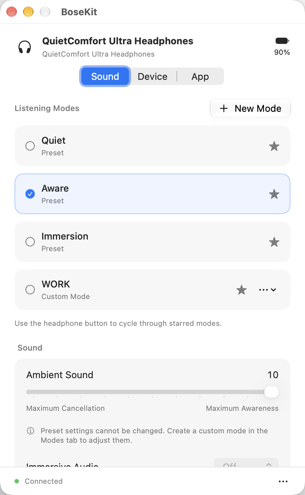

# BoseKit

A macOS menu bar app and Swift library for controlling Bose headphones and earbuds
over Bluetooth, without the Bose app.

> BoseKit is an unofficial project and is not affiliated with or endorsed by Bose
> Corporation. Bose and QuietComfort are trademarks of Bose Corporation.

<p align="center">
  
</p>

## Features

- **Listening modes**: select, create, edit and delete modes; set favorites and the power-on mode
- **Noise control**: noise cancellation level, wind reduction, spatial audio and ANC, as the device supports
- **Equalizer**: bass, midrange and treble
- **Device settings**: name, multipoint, auto pause/answer, self voice, shortcut button, voice prompts and power off
- **Multipoint**: paired devices with their connection state, which one is playing and which one is this Mac
- **Menu bar**: quick controls and battery level; the icon can hide when no device is connected

Available controls depend on what each model supports. The interface is in English and Korean.

## Supported Devices

| Model | Status |
| --- | --- |
| QuietComfort Ultra Headphones (1st Gen) | [Verified on hardware](docs/qc-ultra-1st-gen.md) |
| QuietComfort Ultra Headphones (2nd Gen), QuietComfort Headphones (2nd Gen) | Implemented, untested |
| QuietComfort Ultra Earbuds (2nd Gen) | Implemented, untested |
| QuietComfort Headphones, QuietComfort 45 | Implemented, untested |
| QuietComfort 35 / 35 II | Implemented, untested |
| Noise Cancelling Headphones 700 | Implemented, untested |
| QuietComfort Earbuds | Implemented, untested |
| Ultra Open Earbuds | Implemented, untested; listening-mode layout inferred by bosectl |

Device protocol details are based on [bosectl](https://github.com/aaronsb/bosectl).
Reports for other models are welcome.

## Requirements

- App: macOS 26 or later
- Library (`BoseKitEngine`): macOS 14 or later
- Building from source: Xcode with Swift 6
- The headphones must already be paired with the Mac

## Installing

Download `BoseKit-<version>.dmg` from the [releases page](../../releases), open it and drag BoseKit into Applications.

BoseKit is not notarized by Apple, so macOS blocks it the first time it is opened:

1. Open BoseKit. macOS reports that it cannot verify the app; dismiss the dialog.
2. Open System Settings, go to Privacy & Security and scroll down to Security.
3. Click **Open Anyway** next to the message about BoseKit and confirm.

Alternatively, remove the download quarantine in Terminal before the first launch:

```sh
xattr -dr com.apple.quarantine /Applications/BoseKit.app
```

Allow Bluetooth access when prompted.
Each release is signed ad hoc, so macOS may ask for Bluetooth access again after an update.

## Uninstalling

1. Quit BoseKit from its menu bar icon or its window: open the **…** menu and choose Quit.
2. To forget the Bluetooth permission, reset it while the app is still installed:

```sh
tccutil reset BluetoothAlways dev.jihosong.BoseKit
```

3. Drag BoseKit from Applications to the Trash.
4. To remove its preferences as well, delete the app's container:

```sh
rm -rf ~/Library/Containers/dev.jihosong.BoseKit
```

BoseKit installs nothing else on the Mac.
Settings it changed on the headphones, such as modes or the equalizer, are stored on the headphones and stay as they are.

## Building

Open `BoseKit.xcworkspace` in Xcode, select the **BoseKit** scheme and run.
Allow Bluetooth access when prompted.

Run the app and library tests (UI tests need a paired device and are skipped here):

```sh
xcodebuild test -workspace BoseKit.xcworkspace -scheme BoseKit -destination 'platform=macOS' -skip-testing:BoseKitUITests
```

Build the release disk image, which ends up in `build/`:

```sh
scripts/build-dmg.sh 0.1.0
```

## Using the Library

`BoseKitEngine` is a local Swift package in `Packages/BoseKitEngine`, used by the app:

```swift
import BoseKitEngine

let registry = DeviceRegistry.standard
guard let paired = try RFCOMMTransport.pairedDevices().first(where: { $0.profile(in: registry) != nil }),
      let profile = paired.profile(in: registry) else { return }

let transport = await RFCOMMTransport(address: paired.id, channel: profile.rfcommChannel)
let device = try await BoseDevice.connect(profile: profile, transport: transport)

let battery = try await device.read(BoseFeatures.battery)
try await device.setCNC(5)
await device.close()
```

Every write is verified by reading the value back from the device; a mismatch throws `BoseError.verificationFailed`.
Check `profile.supports(_:access:)` before offering a control.
Values with protocol limits are validated when constructed, so an invalid value never reaches an encoder: `CNCLevel` (0...10), `DeviceName` and `ModeName` (at most 31 UTF-8 bytes without NUL; device names must not be empty), `RFCOMMChannel` (1...30) and `FavoriteModes`.
Integer and string literals of these types are checked at runtime; use `init?(rawValue:)` for user input.
An EQ adjustment is only valid for a device-reported band: build one with `EQBand.adjustment(to:)`, or use `BoseDevice.setEqualizer(band:value:)`, which reads the bands first.
Built-in profiles are also available by name, for example `DeviceProfile.lonestarr`; to support another product, build a registry with `DeviceRegistry(profiles:)` or `register(_:)` on a copy of `DeviceRegistry.standard`.

## Project Structure

```text
Packages/BoseKitEngine/   Swift library: protocol, transport, device profiles and workflows
Packages/BoseKitProbe/    Command-line tool for inspecting what a device reports
BoseKit/                  SwiftUI menu bar app
docs/                     Engine notes and per-device verification notes
```

See [docs/engine-notes.md](docs/engine-notes.md) for architecture and protocol
details, and for how to add a device.

## License

BoseKit is available under the [MIT License](LICENSE).

## Acknowledgements

Protocol layouts and device profiles reference [bosectl](https://github.com/aaronsb/bosectl) (MIT) at commit `5de5b7ee9b6d096a817a5f5eeb4178f39ed70774`; models marked untested follow that reference and have not been retested on hardware with BoseKit.
See `THIRD_PARTY_NOTICES.txt`.
